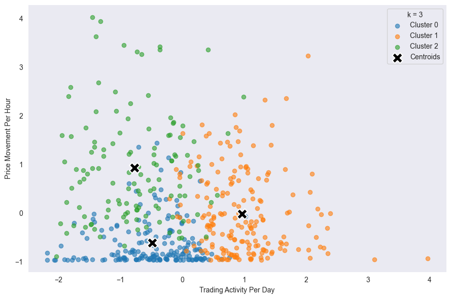
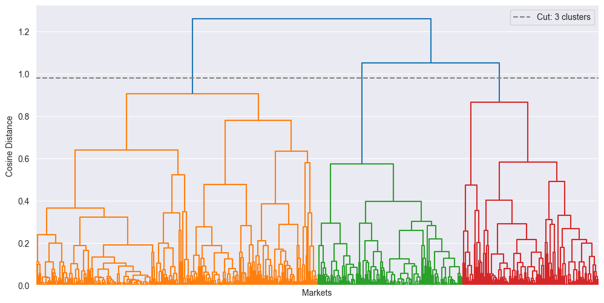
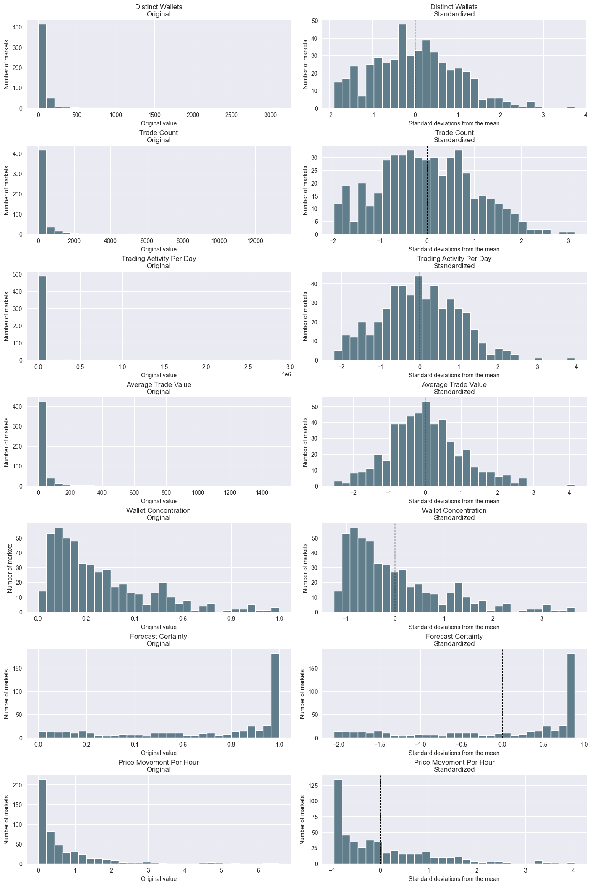
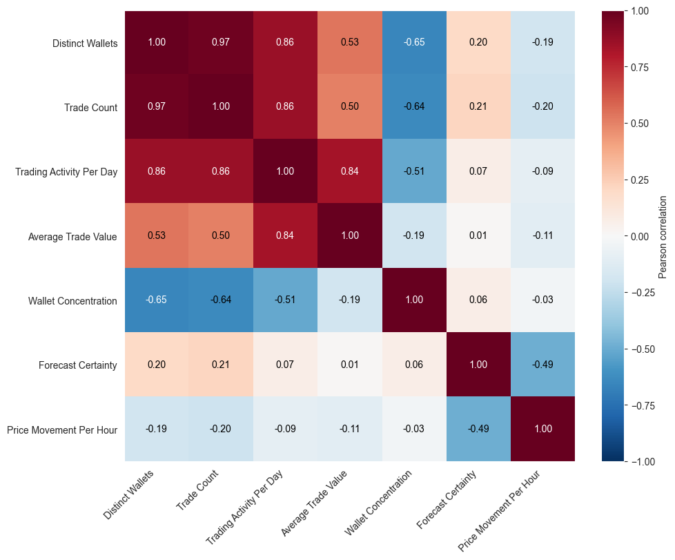
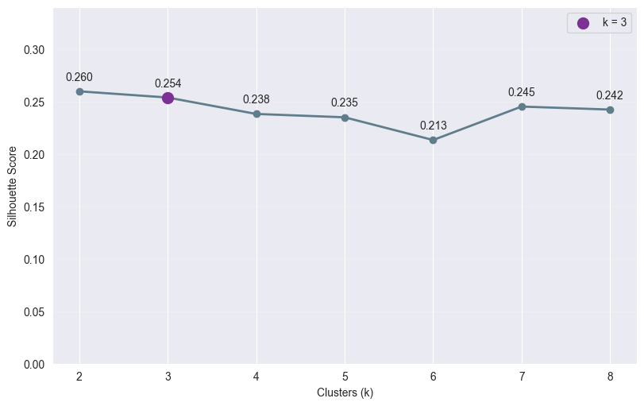
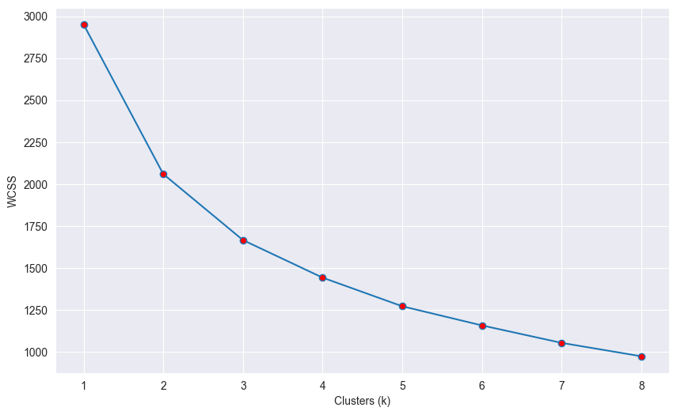
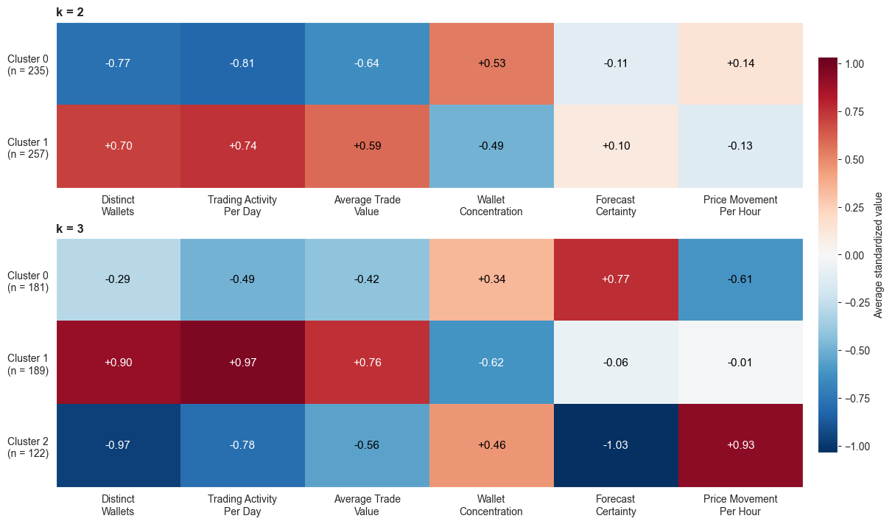
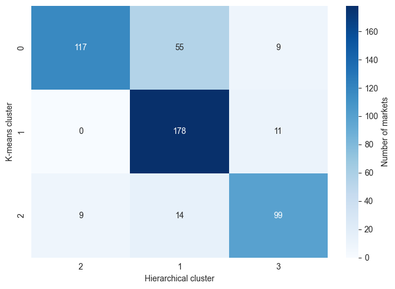
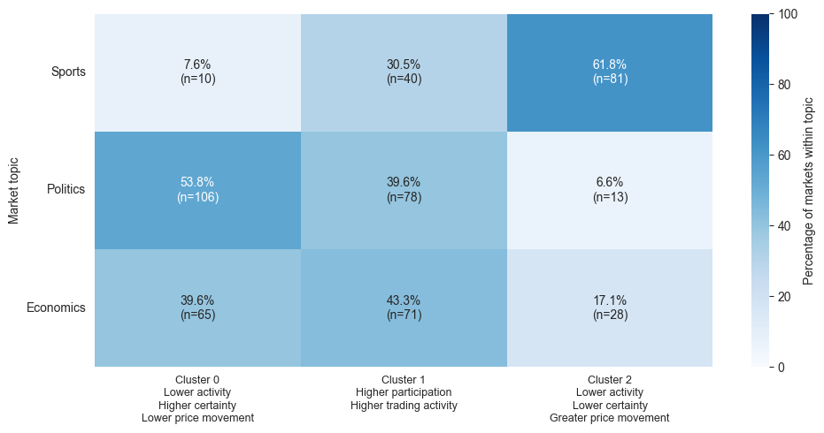

::: {.section-references}
Coding Notebook: [003_clustering](downloads/current/03_clustering.ipynb "Executed Python notebook: clustering preparation, models and figures")
:::

## Overview

The purpose of clustering is to group class-less observations based on their similarity, or lack thereof.  K-means clustering, a partitional method, groups observations by minimizing the within-cluster sum of squares (WCSS).  The iterative process assigns each observation to its nearest centroid, re-calibrates each centroid, and reassigns until convergence.  Hierarchical clustering, on the other hand, starts with every point acting as a single cluster, merging with the nearest cluster until only one remains.

:::: {.method-figure-pair}

::: {.method-figure #figure-11}

[K-means Clustering]{.method-figure-title}  
[{fig-alt="Market-level recorded trading activity per day versus price movement per hour, both log-transformed and standardized. Colors show the k = 3 assignments fitted using six features. Black X markers show those fitted cluster centroids projected onto the two displayed axes."}](#figure-11){.figure-preview aria-haspopup="dialog"}

[Figure 11: K-means partitions observations into k clusters, assigning each observation to its nearest centroid.]{.method-caption}

:::

::: {.method-figure #figure-12}

[Hierarchical/Agglomerative Clustering]{.method-figure-title}  
[{fig-alt="Average-linkage hierarchical clustering with cosine distance on six standardized features. A horizontal cut marks the three-group comparison."}](#figure-12){.figure-preview aria-haspopup="dialog"}

[Figure 12: Hierarchical clustering illustrated in a dendrogram; individual observations placed on x-axis, merge height marked on y-axis.]{.method-caption}

:::

::::

Both techniques were utilized in this analysis to address research question 6: *“Do prediction markets form distinct groups based on participation, trading activity, wallet concentration, forecast certainty, and price movement, and how do these groups differ across Sports, Politics, and Economics?”*  In this case, clustering was employed to investigate whether markets form distinct archetypes based on participation, trade activity/volume, concentration of wallets, and price movement.  The resulting groups were then compared across Sports, Politics, and Economics markets to examine alignment with each topic.  Future work surrounding market accuracy could offer an opportunity to revisit each cluster’s relative prediction power.

Euclidean distance was used for k-means analyses.  Hierarchical clustering used cosine distance with average linkage to define merge height.

## Data Prep

Seven candidate features were selected for clustering.  Market topic was excluded from fitting and retained only for interpreting the resulting clusters.  Each definition reflects the quantity within the 7-day observed market window.

| **Feature** | **Transformation** | **Definition** | **Model Inclusion** |
| --- | --- | --- | --- |
| Distinct Wallets  | ln(1+x) | Number of unique wallets appearing in the market | Clustering & PCA |
| Trade Count  | ln(1+x) | Number of trades; combines records within the same transaction that share the same wallet, outcome, and BUY/SELL side | PCA |
| Trading Activity Per Day | ln(1+x) | Total dollar value recorded divided by collection length window in days; includes BUY and SELL activity | Clustering & PCA |
| Average Trade Value | ln(1+x) | Mean dollar value per trade | Clustering & PCA |
| Wallet Concentration | None | Herfindahl–Hirschman Index (HHI): HHI = Σsᵢ², where sᵢ is wallet i’s share of the market’s total recorded dollar activity | Clustering & PCA |
| Forecast Certainty  | None | 2 × \|p − 0.5\|, where p is the forecast probability at the selected pre-event cutoff | Clustering & PCA |
| Price Movement Per Hour | ln(1+x) | Sum of absolute probability changes, in percentage points, divided by total elapsed hours across adjacent price observations separated by 30–90 minutes | Clustering & PCA |

Table 5: Clustering/PCA feature definitions

Markets were included if all candidate features and at least six price interval observations were available to support the price movement feature.  Of the 565 sampled markets, 67 did not exhibit a trade in the observed window, leaving average trade value and wallet concentration undefined.  An additional six markets were removed for limited usable price history.  A total of 492 observations (131 Sports, 197 Politics, and 164 Economics) remained in the modeling sample.  All 565 markets remain in the full dataset; omissions only apply to clustering and PCA analyses.

Candidate features with strong right-skews were log transformed to reduce the impact of extreme outliers (Table 5).  Each candidate was standardized to have a mean of 0 and standard deviation of 1 across the modeling sample, illustrated in the sample below ([Original CSV](downloads/current/market_features_pre_20.csv); [Prepared CSV](downloads/current/market_features_post_20.csv)):

[Original feature values]{.preparation-table-title}

| **Row** | **Distinct Wallets** | **Trade Count** | **Trading Activity Per Day (\$)** | **Average Trade Value (\$)** | **Wallet Concentration (HHI)** | **Forecast Certainty** | **Price Movement Per Hour (pp)** |
| --- | --- | --- | --- | --- | --- | --- | --- |
| 0 | 287 | 1561 | 5739.911 | 25.740 | 0.033 | 0.480 | 1.080 |
| 1 | 3 | 3 | 2.145 | 5.006 | 0.872 | 0.931 | 1.133 |
| 2 | 48 | 120 | 98.909 | 5.770 | 0.147 | 0.973 | 0.149 |

[Prepared model inputs]{.preparation-table-title}

| **Row** | **Distinct Wallets** | **Trade Count** | **Trading Activity Per Day** | **Average Trade Value** | **Wallet Concentration (HHI)** | **Forecast Certainty** | **Price Movement Per Hour** |
| --- | --- | --- | --- | --- | --- | --- | --- |
| 0 | 1.807 | 1.832 | 1.391 | 0.466 | -1.096 | -0.644 | 0.842 |
| 1 | -1.663 | -1.799 | -1.720 | -0.900 | 3.051 | 0.687 | 0.904 |
| 2 | 0.370 | 0.276 | -0.287 | -0.791 | -0.529 | 0.810 | -0.618 |

Table 6: A sample of three market observations, pre and post log transformation and standardization.

::::: {.method-inline}

:::: {.method-inline-figures}

::: {.method-figure #figure-13}

[Distributions Pre/Post Preparation]{.method-figure-title}  
[{fig-alt="Seven rows compare original candidate feature distributions with values after selected log transformations and standardization."}](#figure-13){.figure-preview aria-haspopup="dialog"}

[Figure 13: Distinct wallets, trade count, trade activity per day, average trade value, and price movement were log-transformed to reduce right-skew.]{.method-caption}

:::

::: {.method-figure #figure-14}

[Feature Correlation Matrix]{.method-figure-title}  
[{fig-alt="Pearson correlations among seven prepared candidate features, including the strong positive correlation between distinct wallets and wallet trade count."}](#figure-14){.figure-preview aria-haspopup="dialog"}

[Figure 14: Trade count held near-perfect correlation with distinct wallets and was removed from cluster models.]{.method-caption}

:::

::::

:::: {.method-inline-copy}

Distributions were then inspected before and after transformation and standardization (Figure 13).

Pairwise correlations between candidates exposed a strong relationship between distinct wallets and trade count (r = 0.97) (Figure 14).  Trade count was excluded from the clustering feature set to avoid duplicative information.

::::

:::::

## Coding

::: {.section-references}
Coding Notebook: [003_clustering](downloads/current/03_clustering.ipynb "Executed Python notebook: clustering preparation, models and figures")
:::

## Results

**K-means Clustering**

K candidate values 1 through 8 were modeled on the six-feature dataset.  Initial centroids were selected with k-means++ to encourage distributed starting points and reduce the risk of misleading convergence at local minimums.  Inertia, silhouette score, and min/max cluster size were recorded for each k iteration.

| **k** | **I****nertia** | **S****ilhouette** **Score** | **S****mallest** **C****luster** | **L****argest** **C****luster** |
| --- | --- | --- | --- | --- |
| 1 | 2952.000 | NaN | 492 | 492 |
| 2 | 2059.992 | 0.260 | 235 | 257 |
| 3 | 1666.473 | 0.254 | 122 | 189 |
| 4 | 1442.646 | 0.238 | 90 | 153 |
| 5 | 1272.075 | 0.235 | 57 | 152 |
| 6 | 1157.994 | 0.213 | 51 | 108 |
| 7 | 1053.940 | 0.245 | 48 | 120 |
| 8 | 974.189 | 0.242 | 24 | 105 |

Table 7: k-means clustering results for k=1 to k=8 across six market features

Silhouette scores were consistently modest across the k values tested.  Inertia decreased without a clear visual elbow.

:::: {.method-figure-pair .method-results-pair}

::: {.method-figure #figure-15}

[Silhouette Score Comparison]{.method-figure-title}  
[{fig-alt="Mean Euclidean silhouette scores for k-means with k from 2 to 8 on six standardized market features; k=1 has no defined silhouette score."}](#figure-15){.figure-preview aria-haspopup="dialog"}

[Figure 15: The maximum silhouette score landed at k=2; however, the metric remained stable throughout test k values.]{.method-caption}

:::

::: {.method-figure #figure-16}

[Elbow Method]{.method-figure-title}  
[{fig-alt="Within-cluster sum of squared distances for k-means with k from 1 to 8."}](#figure-16){.figure-preview aria-haspopup="dialog"}

[Figure 16: The elbow plot displayed no clear bend in the reduction of WCSS as k increased.]{.method-caption}

:::

::::

In tandem, these metrics suggest the markets vary along continuous patterns rather than compact, separated archetypes.  The clusters, then, should be understood as descriptive profiles rather than definitively bound.

Clusters derived from k=2 and k=3 were retained as candidates due to their relatively high silhouette scores.  The cluster profiles were examined for each grouping by comparing standardized and transformed feature means from each cluster.

::: {.method-figure .method-figure-float #figure-17}

[K-means Cluster Profiles]{.method-figure-title}  
[{fig-alt="Mean standardized feature values for the k=2 and k=3 market clusters, with cluster sizes shown beside each row."}](#figure-17){.figure-preview aria-haspopup="dialog"}

[Figure 17: k=3 reveals a grouping that distinguishes low participation markets - high-certainty, stable markets vs low-certainty, volatile markets.]{.method-caption}

:::

The two-cluster output mainly discerned markets based on participation and trade activity/volume.  Cluster 0 illustrates starkly lower participation and trade activity per day.  Average trade value deviated below the sample average; intuitively, wallet concentration tended to be higher in Cluster 0’s smaller markets.  Cluster 1 showed the opposite pattern: higher participation, greater daily trading activity, larger average trades, and lower wallet concentration.  Forecast certainty and price movement were indistinguishing features in the two-cluster model.

The three-cluster model exposed additional differences in cluster archetypes beyond market participation and trade activity.  Cluster 0 and Cluster 2 exhibit below average unique wallets, trade activity per day, and average trade size; however, Cluster 2 markets show a tendency toward high market uncertainty and price movement, unlike Cluster 0.  Cluster 1 is defined by high unique wallets, trade activity per day, and average trade size markets.

Although k=3 produced a slightly lower silhouette score (0.254) than k=2 (0.260), the three-cluster solution provides differentiation among lower-activity markets.  The three clusters distinguished lower-activity markets with more certain forecasts and less price volatility from those with less certain forecasts and greater observed price movement.  The three-cluster model was therefore retained.

**Hierarchical Clustering**

:::: {.method-prose .method-prose-left}

::: {.method-figure #figure-18}

[Hierarchical Dendrogram: Clusters = 3]{.method-figure-title}  
[{fig-alt="Average-linkage hierarchical clustering with cosine distance on six standardized features. A horizontal cut marks the three-group comparison."}](#figure-18){.figure-preview aria-haspopup="dialog"}

[Figure 18: Dendrogram illustrating agglomerative clustering of markets; three intersections at cut-point indicate three resulting clusters]{.method-caption}

:::

Hierarchical clustering was applied to the same six standardized features using cosine distance and average linkage.  Markets began as individual clusters and successively merged based on their pairwise cosine distance. The dendrogram displays these merges, with higher merge heights indicating greater dissimilarity.

::::

:::: {.method-prose .method-prose-right}

::: {.method-figure #figure-19}

[Agreement Between Clustering Methods]{.method-figure-title}  
[Adjusted Rand Index = 0.487]{.method-figure-subtitle}  
[{fig-alt="Counts of markets grouped by k-means and hierarchical cluster. Hierarchical columns are ordered 2, 1, 3 to align the strongest overlaps on the diagonal; adjusted Rand index is 0.487."}](#figure-19){.figure-preview aria-haspopup="dialog"}

[Figure 19: The adjusted Rand index (0.487) shows moderate agreement between k-means and hierarchical clustering methods.]{.method-caption}

:::

The dendrogram did not reveal a definitive cut-point and was not considered sufficient evidence of a true market boundary. The three-cluster solution was therefore retained for direct comparison with the k-means solution using adjusted Rand index (ARI).

The relatively low adjusted Rand index (0.487) suggests grouping agreement well above chance, but with meaningful deviation between the partitional and hierarchical cluster methods.  This could be indicative of different distance measures; k-means utilized Euclidean distance to each centroid whereas hierarchical clustering used pairwise cosine distance.  More foundationally, the discrepancies could reflect the feature’s lack of clear clustering structure, supported by the low silhouette scores and lack of clear cutline in the dendrogram.

::::

**Cluster-Topic Comparison**

:::: {.method-prose .method-prose-right}

::: {.method-figure #figure-20}

[Cluster-Topic Correspondence]{.method-figure-title}  
[{fig-alt="Within-topic percentages and counts for the retained three k-means clusters. Sports: 7.6, 30.5, and 61.8 percent; Politics: 53.8, 39.6, and 6.6 percent; Economics: 39.6, 43.3, and 17.1 percent. Cluster descriptions summarize relative activity, certainty, and price movement."}](#figure-20){.figure-preview aria-haspopup="dialog"}

[Figure 20: The three-cluster solution revealed partial correspondence with market topics.  No single cluster contained a majority of economics markets as sports markets were concentrated in cluster 2.  Cluster descriptions summarize average feature values relative to the sample.]{.method-caption}

:::

Market topics showed partial alignment with the three-cluster solution rather than direct correspondence.  Economics topics were the most evenly distributed across clusters; sports markets were concentrated in cluster 2.  Most political markets landed in cluster 0.

Cluster 1, on the other hand, attracts a notable share of every topic, suggesting that the higher activity market archetype exists across all three topics.

::::

## Conclusions

K-means produced modest silhouette scores across the tested k values, while the hierarchical dendrogram showed no definitive cut-point.  The results suggest some evidence of clustering structure accompanied by continuous patterns and overlap in the market data.  These market archetypes should be interpreted as descriptive profiles rather than rigid market groupings.

The two-cluster solution suggested that market participation and trading activity were the primary drivers distinguishing the market profiles.  The introduction of the third cluster uncovered additional differences in certainty and price movement within the sampled markets, aligning with the PCA structure discussed later.

Despite limited grouping structure, broad topic labels did provide a degree of correspondence with cluster labels in the three-cluster solution.  Sports markets were concentrated in lower-activity, lower-certainty, greater-price-movement profile, while politics markets more often occupied the lower-activity profile with higher certainty and less movement.  The political market correspondence with high certainty markets is notable alongside Le’s (2026) finding that political forecasts were underconfident relative to observed outcomes.  Further research will address this pattern directly in the sample markets.

The topic-cluster correspondence also included significant overlap.  No single cluster contained a majority of economics markets.  Cluster 1 did not illustrate a propensity for any topic, suggesting that the higher activity market archetype is not exclusive to a specific market subject.  Further, these comparisons only apply to observations with all features and sufficient price history; sports markets were disproportionately excluded during data preparation.  Future research will investigate whether these descriptive market profiles help to explain forecast accuracy.
