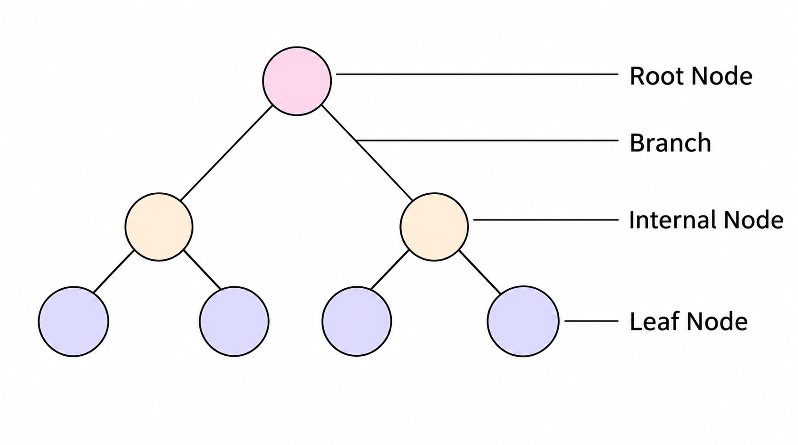
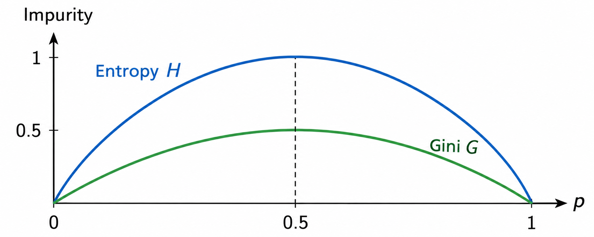
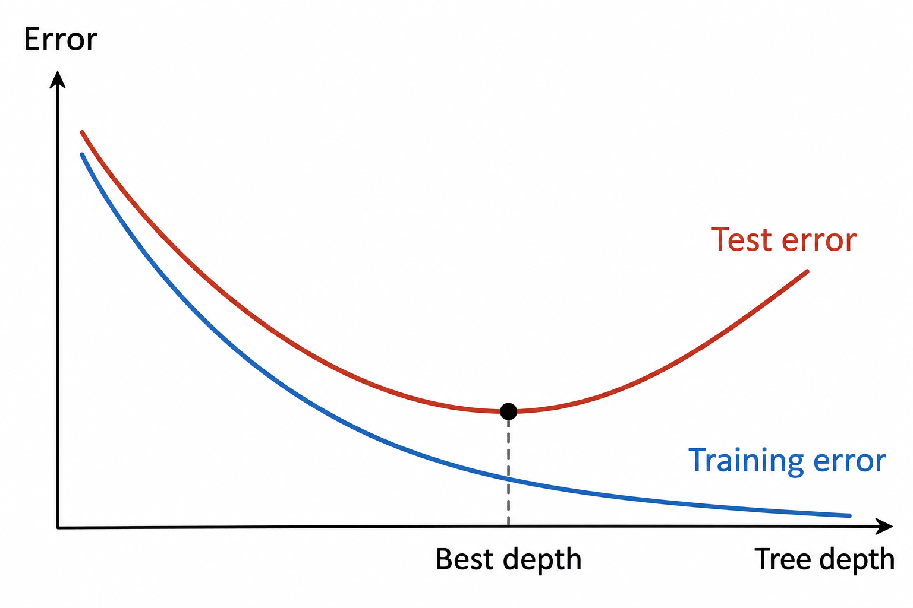
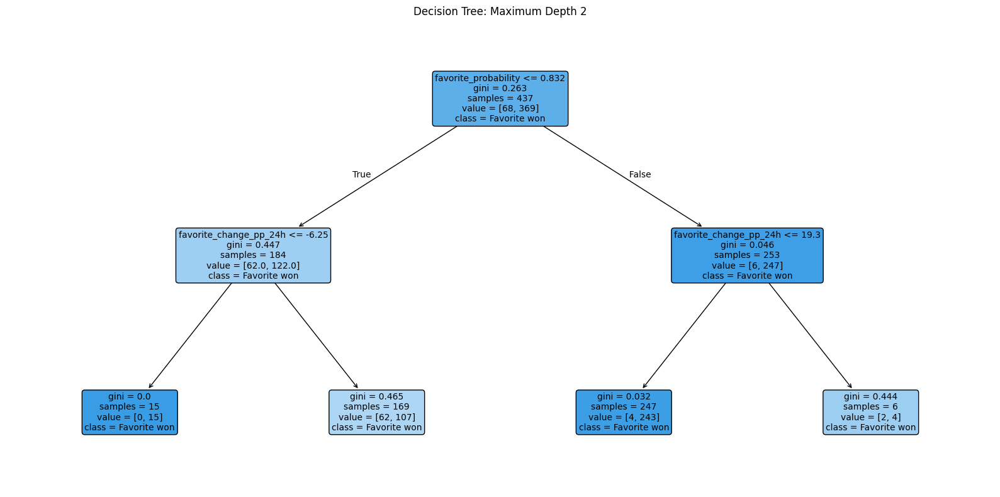
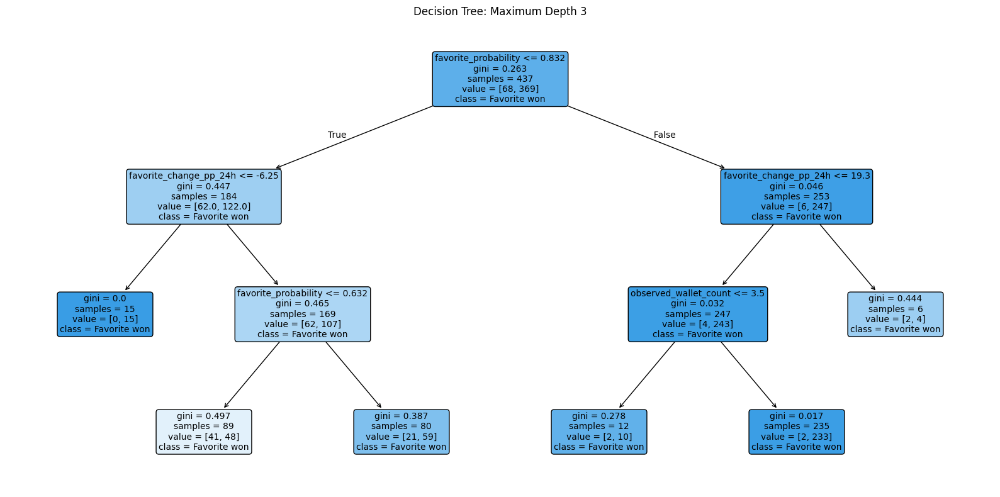
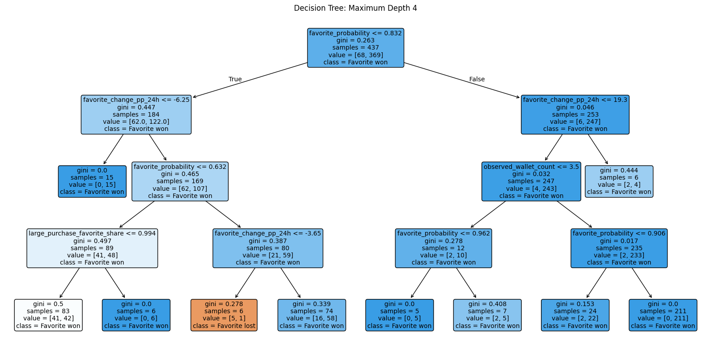
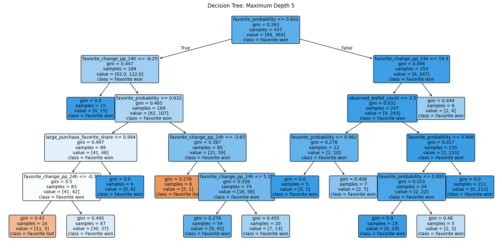
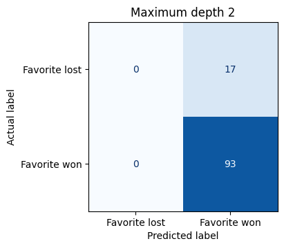
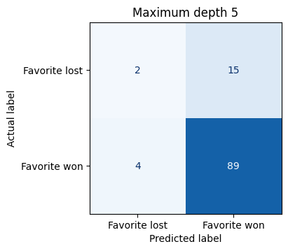
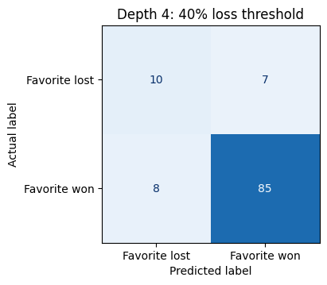

## Overview

:::: {.method-prose .method-prose-right .method-prose-first-paragraph}

::: {.method-figure .source-on-preview #figure-27}

[Decision Tree Structure]{.method-figure-title}  
[{fig-alt="Diagram labeling the root node, branch, internal node, and leaf node of a decision tree."}](#figure-27){.figure-preview aria-haspopup="dialog"}

[Figure 27: Nodes represent splits in the data; leaf nodes assign final class probabilities.  Branches indicate connections an observation can follow.  Depth is the number of branches along the path from the root.]{.method-caption}

:::

Decision trees are a supervised learning method that classifies observations through a sequence of questions, progressively splitting the data into groups with more uniform, or “pure”, class labels.  Without restrictions on split thresholds or tree size, a prediction problem can theoretically be represented by infinitely many trees through alternative root features, split thresholds, branching sequences, and depths.  To find a useful structure from these possibilities, training algorithms use impurity reduction to choose questions and their order, while pre- and post-pruning limit complexity and help reduce overfitting.

Citation: Adapted from www.scaler.com/topics/machine-learning/what-is-decision-trees-in-machine-learning/

How a tree is constructed affects its complexity, bias–variance tradeoff, and predictive performance.  At each node, the goal is to choose a question that reduces class mixing, such that the resulting children nodes are purer than the parent.  Metrics, namely entropy and Gini impurity, provide two measurements for class mixing in a node.

::::

::::: {.method-equation}

[Entropy and Gini Impurity]{.method-figure-title}

[Caption: Entropy and Gini impurity supply two metrics to compare class mixing within a node.]{.method-caption}

:::: {.equation-display}

$$
\text{Entropy:}\quad H = - \sum_{k = 1}^{K}p_{k}{\log_{2}p}_{k}\quad\quad\quad\quad\text{Gini:}\quad G = 1 - \sum_{k = 1}^{K}p_{k}^{2}
$$

::: {.equation-line style="font-size: 83.3333%; padding-top: 1rem;"}

$$
p_{k} = \text{proportion~of~observations~in~class~}k\text{~within~the~current~node}
$$

:::

::::

:::::

:::: {.method-prose .method-prose-left .method-prose-first-paragraph}

::: {.method-figure .method-figure-large .source-on-preview #figure-28}

[Entropy vs Gini]{.method-figure-title}  
[{fig-alt="Entropy and Gini impurity curves plotted against class proportion, with both reaching their maximum at one half."}](#figure-28){.figure-preview aria-haspopup="dialog"}

[Figure 28: While their scales differ, entropy and Gini exhibit the same shape as $p$, the proportion of class k observations, increases towards 1.  With two classes, a perfectly impure node reaches entropy = 1 and Gini = 0.5.]{.method-caption}

:::

Entropy, measured in bits, signals how mixed the class labels are within a node.  With two classes, $H = 1$ indicates equal quantities of both classes.  $H = 0$ denotes a pure class without room for further partition.  Gini impurity, on the other hand, measures the same class mixing while employing squared proportions rather than logs.  Intuitively, the squared proportions ask how likely two randomly pulled class observations will agree, with replacement.  Adding the pairwise probabilities and subtracting from one provides the probability that the pulls will disagree, indicating impurity.

Neither entropy nor Gini impurity is inherently superior; both measure class mixing, reach zero at pure nodes, and reach their maximum when classes are equally represented.  Although their scales differ and entropy is more sensitive to small amounts of mixing, they often favor similar splits.

Citation: Adapted from *Dr. Osita Onyejekwe, course materials*

A comparison of impurity between connecting nodes uncovers the relative usefulness of each potential split.  The decrease in entropy between a parent node and the size-weighted impurity of the children is referred to as information gain; in the case of Gini impurity, it’s called Gini reduction.  Impurity reduction is tried on all question candidates; the candidate with the highest reduction is selected.  In an unpruned tree, the greedy algorithm recurses across all children until every leaf is pure.

::::

::::: {.method-equation}

[Information Gain and Gini Reduction]{.method-figure-title}

[Caption: Information gain and Gini reduction feature the same parent-children comparison with entropy and Gini impurity, respectively.]{.method-caption}

:::: {.equation-display}

$$
\text{Information}\ \text{gain:}\quad IG = H(P) - \sum_{c}^{}\frac{n_{c}}{n}H(c)\quad\quad\quad\quad\text{Gini}\ \text{reduction:}\quad\Delta G = G(P) - \sum_{c}^{}\frac{n_{c}}{n}G(c)
$$

::::

:::::

Expandable example: Entropy and Information Gain

| **Node** | **Favorite won** | **Favorite lost** | **Entropy** |
| --- | --- | --- | --- |
| Parent | 4 | 4 | 1.000 |
| Left child | 3 | 1 | 0.811 |
| Right child | 1 | 3 | 0.811 |

$$IG = 1 - \left( \frac{4}{8} \times 0.811 + \frac{4}{8} \times 0.811 \right) = 0.189\text{~bits}$$

The split reduces uncertainty by 0.189 bits.

:::: {.method-prose .method-prose-right .method-prose-flow}

::: {.method-figure .source-on-preview #figure-29}

[Balancing Bias and Variance with Depth]{.method-figure-title}  
[{fig-alt="Illustration of training error decreasing with tree depth while test error falls and then rises, with the minimum marked as best depth."}](#figure-29){.figure-preview aria-haspopup="dialog"}

[Figure 29: Deep trees are often overfit, exhibiting very little training error while treating noise as signal.  Proper pruning reduces tree depth to balance bias and variance, thereby lowering error in testing and prediction.]{.method-caption}

:::

Aside from a tree’s sequence, pruning acts as a bias–variance lever by reducing depth.  An unpruned tree with pure leaf nodes eliminates training error at the risk of fitting noise in the training dataset.  Pre-pruning restricts growth through preset thresholds, while post-pruning removes branches after training.  Both can sacrifice training accuracy for a simpler tree that may generalize better.

Citation: Adapted from *Dr. Osita Onyejekwe, course materials*

A well-structured tree balances bias and variance to capture meaningful patterns in the training data while limiting overfitting to noise.  The following analysis compares trees with maximum depths of 2, 3, 4, and 5 to evaluate how tree complexity affects classification accuracy and probability estimation on held-out markets.  Model results were then compared to the market’s original forecasts.

::::

## Data Prep

The original prepared dataset included 565 markets, each with a favorite probability recorded 24 hours prior to the observed event. 18 markets had a favorite probability of 50%, without an identifiable favorite. Those 18 were excluded, leaving 547 markets: 462 observed favorite wins and 85 losses.  An outcome label was assigned based on whether the favored outcome at the cutoff matched the observed outcome:

- 1: the favored outcome at the cutoff won

- 0: the favored outcome at the cutoff lost

The same five predictors as Naïve Bayes modeling were used for direct comparison, with two additional variables preserving information about missing predictor values.

| **Predictor** | **Definition** | **Model representation** |
| --- | --- | --- |
| Favorite probability | The probability of the favored outcome at the forecast cutoff | Numeric probability |
| Distinct wallets | Number of unique wallets appearing in the market | Numeric count |
| Large-purchase favorite share | The share of qualifying large-purchase dollars supporting the cutoff favorite; large refers to purchases at least five times the market’s median BUY value | Numeric dollar share |
| Large-purchase status | Describes the availability or reason for absence of large-purchase favorite share | One-hot encoded indicators: available, no_purchases, and no_qualifying_purchases |
| Price trend | The cutoff favorite’s probability at cutoff minus the same outcome’s probability 24 hours earlier | Change in percentage points |
| Price-trend missing | Indicates availability of the price trend | Binary indicator: 1 = missing; 0 = observed |
| Market topic | The defined topic of the market | One-hot encoded indicators: Sports, Politics, and Economics |

Table 12: Decision tree predictors, definitions, and their representation in the model.

Unlike binned representation used for multinomial Naïve Bayes, the decision tree analysis retained numerical predictors.  Favorite probability, distinct wallets, large-purchase favorite share, and price trend were all kept as numerical inputs, and no standardization or scaling was applied.  The Naïve Bayes training/test split was reused: 437 training markets and 110 testing markets, using an 80/20 split and random_state=14.  Stratified sampling preserved the proportion of favored outcome wins and losses.  No individual market appeared in both sets, so the training and test sets were disjoint before transformation.

The modeling sample contained 116 missing purchase-share values and 40 missing trends.  These missing numerical values were imputed with the training-set median for each feature.  The same training-set medians were used to replace missing values in the test set’s corresponding features to prevent leakage.  Missingness indicators (large-purchase status and price-trend missing) were added as features to distinguish observed values from median replacements and capture possible signal from the unavailability of feature values in an observation.  Market topic and large-purchase status were one-hot encoded in the training data to align with scikit-learn’s input requirements; corresponding indicators were then applied to the test set.

The final inputs contained 11 numerical columns.  Snapshots before and after preparation are provided and linked below.

[[Original feature values (CSV)](downloads/current/decision_tree_original_sample.csv){download="decision_tree_original_sample.csv" title="Download CSV"}]{.preparation-table-title}

| **Feature** | **Market 1003803** | **Market 1004446** | **Market 1004698** |
| --- | --- | --- | --- |
| Favorite probability | 0.7400 | 0.9655 | 0.9865 |
| Distinct wallets | 287 | 3 | 48 |
| Large-purchase favorite share | 0.8846 | 1.0000 | 1.0000 |
| Price trend (percentage points) | -1.50 | 0.00 | 0.00 |
| Market topic | Politics | Politics | Economics |

[[Prepared model inputs (CSV)](downloads/current/decision_tree_prepared_sample.csv){download="decision_tree_prepared_sample.csv" title="Download CSV"}]{.preparation-table-title}

| **Feature** | **Market 1003803** | **Market 1004446** | **Market 1004698** |
| --- | --- | --- | --- |
| Favorite probability | 0.7400 | 0.9655 | 0.9865 |
| Distinct wallets | 287 | 3 | 48 |
| Large-purchase favorite share | 0.8846 | 1.0000 | 1.0000 |
| Price trend (percentage points) | -1.50 | 0.00 | 0.00 |
| Price-trend missing | 0 | 0 | 0 |
| Market topic: Economics | 0 | 0 | 1 |
| Market topic: Politics | 1 | 1 | 0 |
| Market topic: Sports | 0 | 0 | 0 |
| Large-purchase status: available | 1 | 1 | 1 |
| Large-purchase status: no purchases | 0 | 0 | 0 |
| Large-purchase status: no qualifying purchases | 0 | 0 | 0 |

Table 13: A sample of three market observations, before and after preparation for decision tree modeling.  Preview data is transposed for readability.

Training and testing markets were disjoint. The examples below selected predictors and the training label. Actual testing outcomes were retained separately to evaluate predictions.

[[Training example (CSV)](downloads/current/decision_tree_training_example.csv){download="decision_tree_training_example.csv" title="Download CSV"}]{.preparation-table-title}

| **Market ID** | **Favorite probability** | **Distinct wallets** | **Outcome label** |
| --- | --- | --- | --- |
| 1313583 | 0.6700 | 0 | 0 (favorite lost) |

[[Testing example (CSV)](downloads/current/decision_tree_testing_example.csv){download="decision_tree_testing_example.csv" title="Download CSV"}]{.preparation-table-title}

| **Market ID** | **Favorite probability** | **Distinct wallets** |
| --- | --- | --- |
| 2168800 | 0.9995 | 53 |

Table 14: Training/test split included 437 training markets and 110 testing markets without duplication.  The subsamples were stratified to include approximately equivalent proportions of favorite wins and losses.  Some features are omitted visually for simplicity.

## Coding

::: {.section-references}
Coding Notebook: [006_decision_trees](downloads/current/06_decision_trees.html "View the saved Decision Trees notebook with code and outputs")
:::

## Results

Trees were pre-pruned to maximum depths of two, three, four, and five, while the minimum training observations per leaf were held constant at five to reduce overfitting.  All four trees began by splitting markets at a favorite probability of 83.2%, separating lower-confidence from higher-confidence forecasts.  Favorite probability provided the greatest initial Gini reduction in the training sample, dropping from 0.2628 in the root to a size-weighted score of 0.2149 in the children.  Increasing depth allowed subsequent branches to divide these groups into more specific subsets.

::::: {.method-figure .method-figure-gallery #figure-30}

[Decision Trees at Maximum Depths Two through Five]{.method-figure-title}

:::: {.method-figure-row}

::: {.method-figure-panel}

[Depth 2]{.method-panel-title}

[{fig-alt="Decision tree with maximum depth two, showing split conditions, Gini impurity, training counts and predicted classes."}](#figure-30){.figure-preview aria-haspopup="dialog"}

:::

::: {.method-figure-panel}

[Depth 3]{.method-panel-title}

[{fig-alt="Decision tree with maximum depth three, showing split conditions, Gini impurity, training counts and predicted classes."}](#figure-30){.figure-preview aria-haspopup="dialog"}

:::

::: {.method-figure-panel}

[Depth 4]{.method-panel-title}

[{fig-alt="Decision tree with maximum depth four, showing split conditions, Gini impurity, training counts and predicted classes."}](#figure-30){.figure-preview aria-haspopup="dialog"}

:::

::: {.method-figure-panel}

[Depth 5]{.method-panel-title}

[{fig-alt="Decision tree with maximum depth five, showing split conditions, Gini impurity, training counts and predicted classes."}](#figure-30){.figure-preview aria-haspopup="dialog"}

:::

::::

[Figure 30: Four trees fitted to the same 437 training markets with Gini impurity and a minimum leaf size of five. The diagrams show the split conditions, Gini impurity, training counts, and predicted class at each node.]{.method-caption}

:::::

The market benchmark correctly classified 93 of 110 test markets (84.5% accuracy).  Despite differing structures, tree depths two through four matched that accuracy by predicting that every market favorite would win.  At depths two and three, every leaf contained more favorite wins than losses, so every path predicted a favorite win at the 50% threshold.  Depth four introduced a leaf predicting favorite losses that was not reached by any of the test markets.  Tree depth five correctly identified two favorite losses but incorrectly predicted four others.  Training accuracy peaked at depth five as test accuracy dropped to 82.7%, suggesting possible overfitting.

::::: {.method-figure .method-figure-gallery #figure-31}

[Decision Tree Confusion Matrices]{.method-figure-title}

:::: {.method-figure-row}

::: {.method-figure-panel}

[Depth 2]{.method-panel-title}

[{fig-alt="Depth two decision tree confusion matrix with actual favorite losses and wins in rows and predicted losses and wins in columns."}](#figure-31){.figure-preview aria-haspopup="dialog"}

:::

::: {.method-figure-panel}

[Depth 3]{.method-panel-title}

[{fig-alt="Depth three decision tree confusion matrix with actual favorite losses and wins in rows and predicted losses and wins in columns."}](#figure-31){.figure-preview aria-haspopup="dialog"}

:::

::: {.method-figure-panel}

[Depth 4]{.method-panel-title}

[{fig-alt="Depth four decision tree confusion matrix with actual favorite losses and wins in rows and predicted losses and wins in columns."}](#figure-31){.figure-preview aria-haspopup="dialog"}

:::

::: {.method-figure-panel}

[Depth 5]{.method-panel-title}

[{fig-alt="Depth five decision tree confusion matrix with actual favorite losses and wins in rows and predicted losses and wins in columns."}](#figure-31){.figure-preview aria-haspopup="dialog"}

:::

::::

[Figure 31: On the same 110 test markets, depths two through four predicted every favorite to win, correctly classifying 93 markets. Depth five identified two of the 17 favorite losses but incorrectly predicted losses for four winning favorites.]{.method-caption}

:::::

Brier score was tested to evaluate the quality of the predicted probabilities.  Brier score averages the squared difference between predicted probabilities and observed outcomes, preserving differences in confidence otherwise omitted in binary classification.  Unlike classification accuracy, Brier score distinguishes a 51% from a 99% forecast.  Although depths two through four produced identical classifications, their probability estimates differed.  Depth four had the lowest Brier score among the models, outperforming Naïve Bayes (0.0998).  However, the market benchmark remained the strongest probability predictor, achieving a Brier score of 0.0873.  The additional complexity introduced in depth five did not improve test performance.

| **Forecast or model** | **Training accuracy** | **Test accuracy** | **Test Brier score** |
| --- | --- | --- | --- |
| Original market forecast | — | 84.5% | 0.0873 |
| Multinomial Naïve Bayes | — | 84.5% | 0.0998 |
| Decision tree: depth 2 | 84.4% | 84.5% | 0.1002 |
| Decision tree: depth 3 | 84.4% | 84.5% | 0.0946 |
| Decision tree: depth 4 | 85.4% | 84.5% | 0.0931 |
| Decision tree: depth 5 | 86.7% | 82.7% | 0.1033 |

Table 15: A comparison of training accuracy, testing accuracy, and Brier scores across the original markets, the multinomial Naïve Bayes model, and all tested tree depths.

:::: {.method-prose .method-prose-right .method-prose-first-paragraph}

::: {.method-figure #figure-32}

[Depth Four Threshold Comparison]{.method-figure-title}  
[{fig-alt="Depth four decision tree at a 40 percent favorite-loss threshold: 10 actual losses predicted as losses, seven predicted as wins, eight actual wins predicted as losses, and 85 predicted as wins. Test accuracy is 86.4 percent."}](#figure-32){.figure-preview aria-haspopup="dialog"}

[Figure 32: Lowering the loss-prediction threshold to 40% in the depth four tree slightly increased classification accuracy over the default threshold at the same depth.]{.method-caption}

:::

In an exploratory comparison, lowering depth-four’s tree loss prediction threshold from 50% to 40% increased test accuracy from 84.5% to 86.4%.  The adjusted threshold correctly identified 10 favorites that lost while incorrectly flagging eight winning favorites, a net increase of two correct classifications.  Brier score remained in line with the balanced threshold at depth four as probability estimates did not change.

::::

## Conclusions

The prediction markets remain the strongest probability benchmark (Brier = 0.0873), outpacing multinomial Naïve Bayes (0.0998) and the highest performing decision tree (0.0931).  This result supports the strength of prediction markets across topics and market behaviors in the sample—neither modeling approach has established a reliable Brier score improvement over the sampled marketing forecasts.  Classification improved on the sample after lowering the prediction-loss threshold, suggesting the features provided useful information that the default 50% classification thresholds did not expose.  However, further validation is required to determine whether that improvement extends to new markets.

The class-imbalance weighted towards favorite wins could provide direction for future research.  Weighting favorite-loss observations more heavily during training could help trees identify patterns associated with these less common outcomes.  While minority class oversampling does not add any incremental information, it could increase favorite-loss influence.  These approaches could be investigated using the existing sample, given the substantial effort required to collect and validate additional markets.  Lastly, each predictor’s added value could be assessed individually by pairing it with favorite probability and comparing performance.
