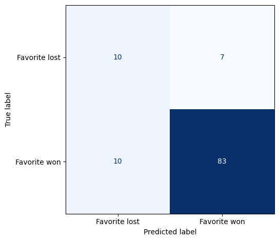

## Overview

Naïve Bayes is a supervised classifier based on Bayes’ theorem, which uses the prior and conditional likelihoods of feature vectors to assign relative class probability scores to each new observation.  Naïve Bayes scales this logic by adopting the naïve assumption: features are conditionally independent given their class.  While this is a strong assumption—often features within a class are related—it eliminates the need to estimate and store separate probabilities for each feature combination.  Rather, the model learns individual probabilities for each feature within a particular class.

::::: {.method-equation}

[Bayes’ Theorem]{.method-figure-title}

[Bayes’ theorem estimates the posterior by finding the product of the prior and likelihood, then dividing by the evidence, a constant.]{.method-caption}

:::: {.equation-display}

$$
P(A \mid B) = \frac{P(B \mid A)P(A)}{P(B)}
$$

::::

:::::

::::: {.method-equation}

[Naïve Bayes]{.method-figure-title}

[The naïve assumption allows for the multiplication of individual feature probabilities and the prior; the resulting score is proportional to the probability of class c.]{.method-caption}

:::: {.equation-display}

$$
P(y = c \mid x) \propto P(y = c)\prod_{j = 1}^{d}P\left( x_{j} \mid y = c \right)
$$

::::

:::::

Despite the oft-incorrect independence assumption, Naïve Bayes is considered a strong classifier, commonly used for spam detection, topic categorization, and sentiment analysis.  A family of variants maintains the naïve assumption while adapting to different feature types.  Multinomial Naïve Bayes, used in this analysis, represents features as nonnegative counts; in this analysis, one-hot encoding supplies counts of zero or one.  The prior represents the proportion of training observations in each class, while feature counts within each class are used to estimate likelihoods.  Laplace smoothing adds one to each feature count to prevent an absent training feature from ruling out a class during prediction.  Each feature count $x_{j}$ is multiplied by ${\log\theta}_{cj}$.  These contributions are summed and added to the log prior, $logP(y = c)$, to produce a score for each class.  The observation is attributed to the class with the highest score.

::::: {.method-equation}

[Multinomial Naïve Bayes]{.method-figure-title}

[The multinomial variant classifies based on relative counts within the training data for each class.]{.method-caption}

:::: {.equation-display}

$$
P(y = c \mid x) \propto P(y = c)\prod_{j = 1}^{d}\theta_{cj}^{x_{j}}
$$

::::

:::::

Bernoulli Naïve Bayes accommodates yes-no indicators, recorded as 1 or 0.  Features with richer information, such as counts, are simplified into a binary, present-or-absent indicator.  Unlike multinomial Naïve Bayes, the absence of a feature in an observation serves as evidence.  Theta ($\theta_{cj}$) represents the probability that a particular feature ($j$) is present within a particular class ($c$)—for example, the probability that ‘prize’ appears in a spam email.  $1 - \theta_{cj}$ is the probability that it is absent.  The more expected a feature is in a class, the more surprising its absence becomes.

::::: {.method-equation}

[Bernoulli Naïve Bayes]{.method-figure-title}

[Unlike multinomial Naïve Bayes, the Bernoulli variant treats the absence of a feature as evidence.]{.method-caption}

:::: {.equation-display}

$$
P(y = c \mid x) \propto P(y = c)\prod_{j = 1}^{d}\left\lbrack \theta_{cj}^{x_{j}}\left( 1 - \theta_{cj} \right)^{1 - x_{j}} \right\rbrack
$$

::::

:::::

This analysis used one-hot encoded market features to predict whether the favored outcome ultimately occurred with multinomial Naïve Bayes.  Model results were then compared to the market’s original forecasts.

## Data Prep

The original prepared dataset included 565 markets, each with a favorite probability recorded 24 hours prior to the observed event.  18 markets had a favorite probability of 50%, without an identifiable favorite.  Those 18 were excluded, leaving 547 markets: 462 observed favorite wins and 85 losses.  An outcome label was assigned based on whether the favored outcome at the cutoff matched the observed outcome:

- 1: the favored outcome at the cutoff won

- 0: the favored outcome at the cutoff lost

5 predictors were selected.  Each was split into categories for modeling.

| **Feature** | **Categories** | **Definition** |
| --- | --- | --- |
| Favorite probability | lower, middle, higher | The probability of the favored outcome at the forecast cutoff |
| Distinct wallets  | lower, middle, higher | Number of unique wallets appearing in the market |
| Large-purchase direction | favorite, underdog, equal, no purchases, no qualifying purchases | The share of qualifying large-purchase dollars supporting the cutoff favorite; large refers to purchases at least five times the market’s median BUY value |
| Price trend | gaining, losing, unchanged, unavailable | The cutoff favorite’s probability at cutoff minus the same outcome’s probability 24 hours earlier |
| Market topic | Sports, Politics, Economics | The defined topic of the market |

Table 9: Naïve Bayes predictors, definitions, and named categories for one-hot encoding.

Features were stored in X_raw and the labels in y_model.  The train/test split was set at 80/20 with stratified sampling to preserve the proportion of favored outcome wins and losses; a fixed random state was used for reproducibility.  Labeled categories were created for each predictor.  Favorite probability and distinct wallets were divided into three approximately equal-frequency categories—lower, middle, and higher—using boundaries learned from the training data and applied to the test data.  Large-purchase direction and price trend were categorized using their predefined rules, while market topic retained its existing labels.  Missing values were kept as specific categories to provide information rather than being interpreted as zero values.  The 116 markets without an available large-purchase direction were categorized as “no purchases” or “no qualifying purchases”.  The 40 markets without a price trend due to short, pre-cutoff market durations were labeled as “unavailable”.

The categories were then one-hot encoded to create a total of 18 binary indicators.  Snapshots before and after preparation are provided and linked below.

[[Original feature values (CSV)](downloads/current/naive_bayes_original_sample.csv){download="naive_bayes_original_sample.csv" title="Download CSV"}]{.preparation-table-title}

| **Feature** | **Market 1003803** | **Market 1004446** | **Market 1004698** |
| --- | --- | --- | --- |
| Favorite probability | 0.7400 | 0.9655 | 0.9865 |
| Distinct wallets | 287 | 3 | 48 |
| Large-purchase favorite share | 0.8846 | 1.0000 | 1.0000 |
| Price trend (percentage points) | -1.50 | 0.00 | 0.00 |
| Market topic | Politics | Politics | Economics |

[[Prepared model inputs (CSV)](downloads/current/naive_bayes_prepared_sample.csv){download="naive_bayes_prepared_sample.csv" title="Download CSV"}]{.preparation-table-title}

| **Feature** | **Market 1003803** | **Market 1004446** | **Market 1004698** |
| --- | --- | --- | --- |
| Favorite probability: higher | 0 | 0 | 1 |
| Favorite probability: lower | 1 | 0 | 0 |
| Favorite probability: middle | 0 | 1 | 0 |
| Distinct wallets: higher | 1 | 0 | 1 |
| Distinct wallets: lower | 0 | 1 | 0 |
| Distinct wallets: middle | 0 | 0 | 0 |
| Large-purchase direction: equal | 0 | 0 | 0 |
| Large-purchase direction: favorite | 1 | 1 | 1 |
| Large-purchase direction: no purchases | 0 | 0 | 0 |
| Large-purchase direction: no qualifying purchases | 0 | 0 | 0 |
| Large-purchase direction: underdog | 0 | 0 | 0 |
| Price trend: gaining | 0 | 0 | 0 |
| Price trend: losing | 1 | 0 | 0 |
| Price trend: unavailable | 0 | 0 | 0 |
| Price trend: unchanged | 0 | 1 | 1 |
| Market topic: Economics | 0 | 0 | 1 |
| Market topic: Politics | 1 | 1 | 0 |
| Market topic: Sports | 0 | 0 | 0 |

Table 10: A sample of three market observations, before and after preparation for multinomial Naïve Bayes modeling.  Preview data is transposed for readability.

## Coding

::: {.section-references}
Coding Notebook: [005_naive_bayes](downloads/current/05_naive_bayes.html "View the saved Naive Bayes notebook with code and outputs")
:::

## Results

Model results were benchmarked against the original market forecasts for both classification performance and probability estimation on the same 110 test markets.  Accuracy evaluates whether the predicted class was correct, while Brier score evaluates the quality of the predicted probabilities.  Brier score averages the squared difference between predicted probabilities and observed outcomes, preserving differences in confidence otherwise omitted in binary classification.  Unlike classification accuracy, Brier score distinguishes a 51% from a 99% forecast.

| **Forecast** | **Accuracy** | **Brier score** |
| --- | --- | --- |
| Multinomial Naïve Bayes | 84.5% | 0.0998 |
| Original market forecast | 84.5% | 0.0873 |

Table 11: Comparison of accuracy and Brier score between multinomial Naïve Bayes and market forecasts at cutoff.

:::: {.method-prose .method-prose-right .method-prose-flow}

::: {.method-figure #figure-26}

[Multinomial Naïve Bayes Confusion Matrix]{.method-figure-title}  
[{fig-alt="Confusion matrix for 110 test markets. Of 17 favorite losses, 10 were predicted as losses and seven as wins. Of 93 favorite wins, 10 were predicted as losses and 83 as wins."}](#figure-26){.figure-preview aria-haspopup="dialog"}

[Figure 26: The multinomial model correctly identified 10 of the 17 markets with favored outcome losses, but incorrectly classified losses for 10 markets where the favorite won.]{.method-caption}

:::

Both approaches correctly classified 93 of 110 markets, producing identical accuracy of 84.5%.  The market benchmark always predicted that the cutoff favorite would win.  Naïve Bayes used the favorite’s probability alongside the selected features to predict whether the favorite would win or lose.  This allowed the model to identify potential favorite losses rather than consistently select the favored outcome.

The model correctly identified 10 of the 17 favorite losses.  However, it also predicted losses for 10 winning favorites, offsetting that improvement and leaving overall accuracy unchanged.  Although the Naïve Bayes model did not improve classification accuracy overall, it identified a subset of markets with a much higher rate of favorite losses: among the 20 markets predicted to have a favorite loss, 10 (50%) actually did, compared with 17 of 110 markets (15.5%) across the full test sample.

The original market forecasts achieved a lower Brier score (0.0873) than Naïve Bayes (0.0998), indicating lower average squared error in market probability estimates.  Although both approaches achieved the same classification accuracy, the market forecasts performed better when prediction confidence was considered.

::::

## Conclusions

The results support the idea of “wisdom in crowds” as the markets provided a strong benchmark.  The Naïve Bayes model could not exceed the markets’ classification accuracy; 10 correctly identified losses among favored outcomes were offset by 10 false positives in the test sample.  Therefore, the model features—wallet participation, large-purchase direction, price trend, and topic—did not translate to better overall classification performance in this analysis.  However, the confusion matrix could suggest the features contain useful information.  The subset of markets classified as “favorite lost” had a much higher proportion of observed favorite losses than the general sample.

The model’s Brier score fell short of the market forecast benchmark.  Violations of the independence assumption can distort probability estimation without changing which class receives the highest probability.  Naïve Bayes can therefore retain useful classification performance while producing less reliable probability estimates.

It is possible that data preparation and model selection limited the performance of the model.  The categorization of each continuous predictor removed potentially useful distinctions between markets.  For instance, observed increases of 0.05 and 46 percentage points in the favorite’s probability were represented identically in the price-trend feature, discarding the difference in gaining magnitude in the 24 hours before cutoff.  Future research could assess whether individual predictors improve performance beyond using the favorite’s forecast probability.  While feature categories were intentionally kept broad enough to ensure an adequate number of observations in each, more granularity could preserve differences in forecast certainty and the magnitude of price changes.  Alternatively, models that accept continuous predictors could retain these distinctions without categorization.
