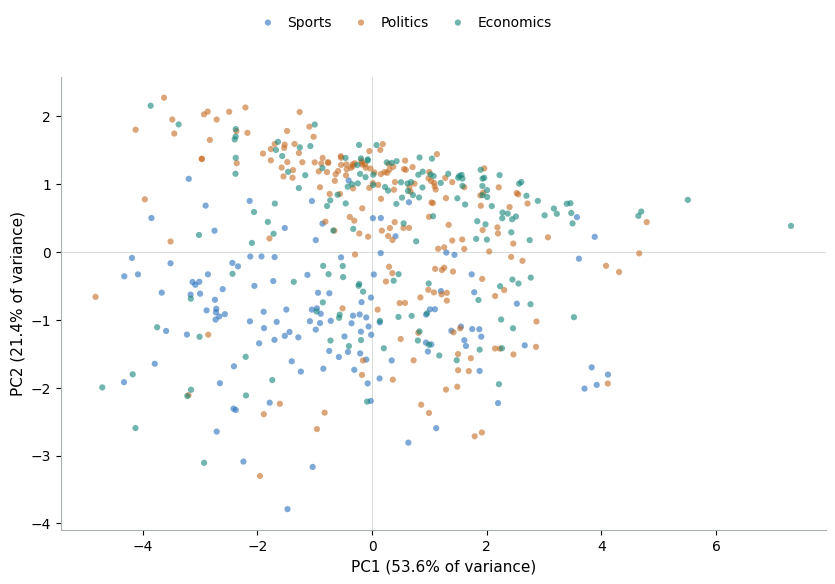
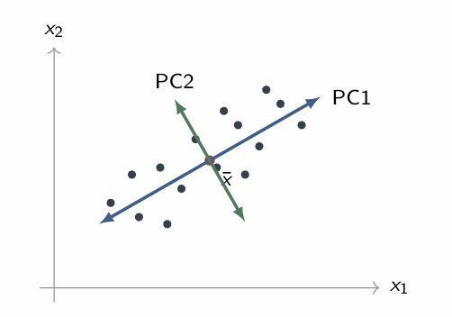
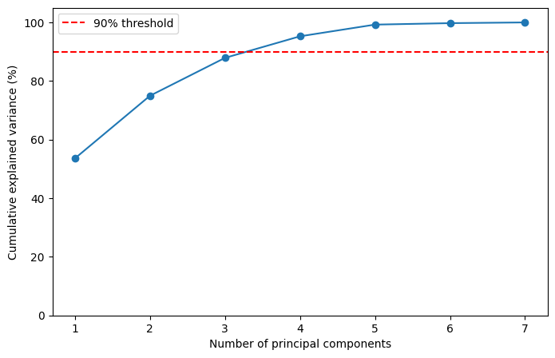
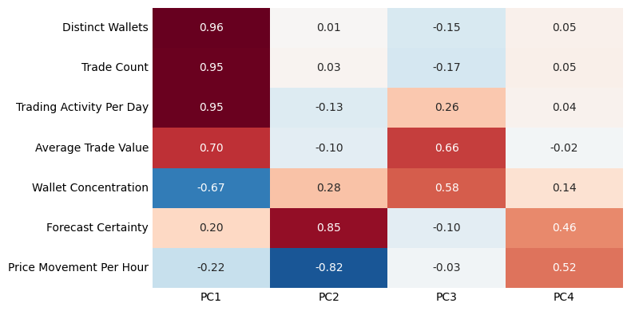
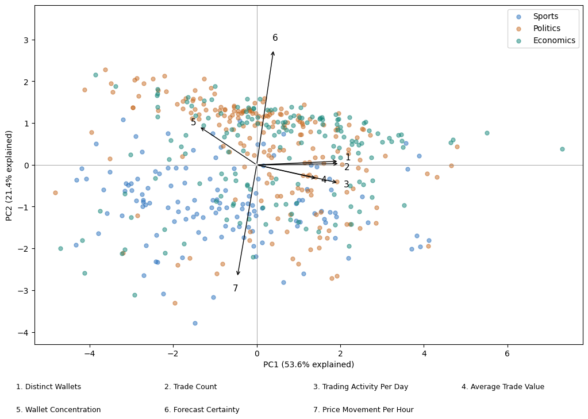

## Overview

:::: {.method-prose .method-prose-left}

::: {.method-figure #figure-21}

[Simplified Visualization in PC Space]{.method-figure-title}  
[{fig-alt="PC1-PC2 scatterplot of 492 markets, colored by Sports, Politics and Economics. The axes explain 53.6 and 21.4 percent of total variance, respectively."}](#figure-21){.figure-preview aria-haspopup="dialog"}

[Figure 21: Seven market features are reduced to two-dimensions in PC space; collaboratively, PC1 and PC2 explain 75% of the variance in the modeled data.]{.method-caption}

:::

Principal component analysis (PCA) is a form of dimensionality reduction that represents many correlated features with fewer variables while retaining as much original variation as possible.  High dimensional data can increase the computational demands of modeling and make relationships between features difficult to interpret and visualize.  By combining many features into uncorrelated components, PCA consolidates shared patterns in the data, decreases future modeling complexity, and enables two- or three-dimensional visualization.  On the contrary, PCA risks dropping meaningful variance and yields blended, often opaque components.

::::

:::: {.method-prose .method-prose-right}

::: {.method-figure #figure-22}

[PCA Yields Perpendicular Eigenvectors]{.method-figure-title}  
[{fig-alt="Diagram of observations in two original feature dimensions, with PC1 along the greatest variation and PC2 perpendicular to PC1, intersecting at the data mean. Source: Dr. Osita Onyejekwe, course materials."}](#figure-22){.figure-preview aria-haspopup="dialog"}

[Figure 22: PC1 captures the greatest variance, while PC2 captures the greatest remaining variance perpendicular to PC1. (*Source: Dr. Osita Onyejekwe, course materials*)]{.method-caption}

:::

Individual components can be decomposed into three fundamental units: eigenvalues, eigenvectors, and principal component scores.  Eigenvalues are scalars, indicating the variance that is explained by each PC.  Eigenvectors imply the directions of each respective axis, each perpendicular to all other existing PCs.  Finally, the PC scores convey the projection of the original observations onto the axis.

The seven-feature dataset included in the prediction market analysis is not considered high-dimension data.  However, PCA remains beneficial by consolidating previously identified correlated features and facilitating interpretable visualization.

::::

## Data Prep

Like clustering, seven numeric candidate features were selected for PCA modeling (Table 5).  Market topic was excluded from fitting.  Markets were included only when all seven features and at least six usable price intervals were available.  Of the 565 sampled markets, 67 did not exhibit a trade in the observed window, leaving average trade value and wallet concentration undefined.  An additional six markets were removed for limited usable price history.  A total of 492 observations (131 Sports, 197 Politics, and 164 Economics) remained in the modeling sample.  All 565 markets remain in the full dataset; omissions only apply to clustering and PCA analyses.

Candidate features with strong right-skews were log transformed to reduce the impact of extreme outliers (Table 5).  Each candidate was standardized to have a mean of 0 and a standard deviation of 1 across the modeling sample to unify feature scales.  Distributions were then inspected before and after transformation and standardization (Figure 13).  Unlike clustering, trade count remained in the modeling sample despite correlation with distinct wallets.  A sample of pre and post log transformation and standardization data is shown in Table 6 ([Original CSV](downloads/current/market_features_pre_20.csv); [Prepared CSV](downloads/current/market_features_post_20.csv)).

## Coding

::: {.section-references}
Coding Notebook: [004_pca](downloads/current/04_pca.ipynb "Executed Python notebook: PCA preparation, components and figures")
:::

## Results

**Component Selection & Explained Variance**

PCA results confirmed that variance among the seven market features could be consolidated into a smaller subset of components.  Three principal components captured 87.9% of variance; a fourth PC brought the cumulative total to 95.3%, exceeding the 90% variance threshold.  Four principal components were kept; adding PC5 explains only 4% more variance.

::::: {.method-table-figure-pair}

:::: {.method-table-panel}

| **Component** | **Variance explained (%)** | **Cumulative variance (%)** |
| --- | --- | --- |
| **PC1** | **53.6** | **53.6** |
| **PC2** | **21.4** | **75.0** |
| **PC3** | **12.9** | **87.9** |
| **PC4** | **7.4** | **95.3** |
| **PC5** | **4.0** | **99.3** |

Table 8: Proportional variances explained for PC1 through PC5

::::

::: {.method-figure #figure-23}

[Cumulative Variance Explained by PCA]{.method-figure-title}  
[{fig-alt="Cumulative explained variance for one through seven principal components. Four components retain 95.3 percent, exceeding the dashed 90 percent threshold."}](#figure-23){.figure-preview aria-haspopup="dialog"}

[Figure 23: Four principal components are required to explain 90% of variance; the upward gradient flattens after PC4.]{.method-caption}

:::

:::::

**Component Representation**

Loadings describe the magnitude and direction of the relationship between each feature and its principal component.  Larger absolute values reflect strong relationships; positive and negative signs indicate their directions.

::: {.method-figure .method-figure-float #figure-24}

[PCA Component Loadings]{.method-figure-title}  
[{fig-alt="Loadings of seven market features on PC1 through PC4, computed as component weights multiplied by square roots of eigenvalues. Red denotes positive relationships and blue denotes negative relationships."}](#figure-24){.figure-preview aria-haspopup="dialog"}

[Figure 24: PC1’s loadings indicate an axis distinguishing high activity, high participation markets from smaller, low activity markets.]{.method-caption}

:::

The loadings heatmap illustrates a strong positive relationship across market participation and activity for PC1, suggesting an influential shared pattern across the features.  PC2’s loadings identify another dimension of variation that is not captured in PC1 – markets also differ in their certainty and stability beyond the activity patterns summarized in PC1.  Higher PC3 scores are associated with larger average trade values and greater wallet concentration.  Forecast certainty and price movement load positively on PC4, contrasting with the opposing directions of the two features shown in PC2.

[**Biplot Analysis**]{.method-subsection-title}

Figure 25 plots market scores on PC1 and PC2, with arrows showing component weights enlarged for visibility.

::: {.method-figure .method-figure-float #figure-25}

[Biplot: PC1 and PC2]{.method-figure-title}  
[{fig-alt="Markets projected onto PC1 and PC2, colored by topic, with seven numbered component-weight arrows enlarged for visibility. PC1 and PC2 explain 53.6 and 21.4 percent of variance."}](#figure-25){.figure-preview aria-haspopup="dialog"}

[Figure 25: The PC1 / PC2 biplot illustrates a positive relationship for arrows 1-4, running parallel to PC1.]{.method-caption}

:::

Arrows 1 through 4, representing participation and activity features, are generally parallel to PC1, consistent with the strong positive relationship shown in the PC1 loadings.  Wallet concentration points left, suggesting that the busier markets tend to have more evenly distributed wallet trading.  Forecast certainty and price movement illustrate opposing directions for certainty and price volatility along the PC2 axis.

The observations, categorized by market topic, could suggest a pattern of differentiation related to market subject matter.  Sports markets appear more concentrated toward lower PC2 scores, corresponding to lower forecast certainty and greater price movement.  However, substantial overlap remains across the market topics, and the plotted area does not capture all variance in the dataset.

## Conclusions

While the market dataset is not high-dimensional, the PCA analysis confirmed significant overlap in the information carried by the seven features.  Over 95% of variability was explained in the four components retained.  Market participation and activity were weighted heavily in PC1, which contributed 53.6% of variance.  The remaining components carried substantial information surrounding certainty, price movement, average trade value, and wallet concentration, suggesting market behavior cannot be sufficiently described using participation and activity metrics alone.

These results complement the clustering analysis, with both methods highlighting participation and trading activity as a major pattern and forecast certainty and price movement as an additional distinction among markets.
